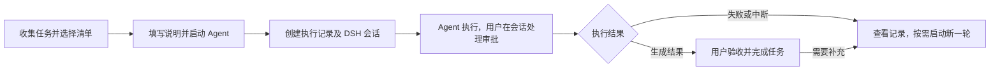

# 以任务驱动 Agent 的 DSH 插件

## 用户流程

用户在 DSH 的「AI 清单」中收集任务，选择收件箱或项目清单。打开一项任务后，填写执行说明，写清输入、目标和验收标准。选择 DSH 工作区并启动，插件为这次执行创建专属会话，把任务交给 Agent。用户可以从原任务查看执行状态、打开会话处理审批和查看产物。确认结果满足要求后，用户标记任务完成。

[可点击原型](./dsh-plugin-prototype.html)使用模拟数据。打开「整理会议纪要」可走通执行和验收，也可以新建任务并选择清单。

首版采用显式启动、每轮一个 Agent 会话。多 Agent 编排可在后续接入 DSH 的可选 Workflow 能力，其引擎以一个已运行的父 Agent 为入口。任务入口和执行记录可以沿用。 [DSH Workflow 子系统](https://github.com/deepseek-ai/deepseek-harness/blob/e8f7b93/docs/subsystems/workflow.md)

## 数据与状态

- 任务可保存一个默认 DSH 工作区。新增可空字段 `dsh_workspace_id`，存 DSH 的 `WorkspaceId`，在首版配置的单一 Host 内解析。新任务可以先收集，首次执行前在任务详情选择工作区，保存后下一轮自动带出。改绑只影响后续执行，移动到其他清单也保留绑定。
- 工作区选择器从当前 DSH Host 读取允许创建会话的已注册工作区，显示名称和目录以区分同名项目。重命名后按 ID 显示新名称。工作区被删除、当前不可访问或目录不可用时提示重新选择，启动前由 Host 再次校验。
- 清单和任务继续由 FastAPI 和 PostgreSQL 管理。任务的 `description` 存执行说明，`list_id` 存归属清单，现有任务状态表达用户是否完成任务。桌面端和 CLI 可以继续管理同一份数据。
- 新建 `task_runs` 表，一行代表一次执行。记录 `id`（请求 UUID）、`task_id`、`session_id`（唯一，启动前分配）、`executor_id`（DSH Host 标识）、`workspace_id`、`workspace_path`、`title_snapshot`、`instructions_snapshot`、`status`、`created_at`、可空的 `finished_at` 和 `failure_reason`。启动时保存输入和工作区快照。会话和产物保留在 DSH，数据库记录会话定位信息。
- 执行状态为 `starting → running → succeeded / failed / cancelled / interrupted`。启动失败可直接从 `starting` 转为 `failed`。审批属于 DSH 会话交互，执行记录在等待审批时仍为 `running`。界面将 `succeeded` 显示为「待验收」，任务完成后显示「已完成」。
- 首版支持同一份任务数据关联一个配置了稳定 ID 的 DSH Host。每项任务最多一条活跃执行，由 `task_id` 上针对 `starting` 和 `running` 的部分唯一索引保证。历史按 `task_id, created_at, id` 查询。删除任务时拒绝仍在执行的任务，永久删除任务时级联删除执行关联，会话按 DSH 的生命周期管理。首版执行入口面向普通任务，周期实例需要独立的执行身份和验收规则。
- Agent 输出结束后，用户从面板确认完成，走现有完成接口。结果需补充时保留旧记录，更新说明后启动新一轮。失败和中断不会修改待办状态。

## 接口

| 操作 | 接口 | 契约 |
| --- | --- | --- |
| 选择清单 | 现有 `GET /api/v1/lists` 和 `GET /api/v1/tasks?list_id=…` | 列出可用清单。按选中的清单 ID 查询待办，沿用 `next_cursor`。 |
| 新建、编辑 | 现有 `POST /api/v1/tasks`、`PATCH /api/v1/tasks/{id}` | 新建传 `title` 和选定的 `list_id`。执行说明保存到 `description`。 |
| 保存绑定 | 扩展 `PATCH /api/v1/tasks/{id}` 和任务响应 | 新增可空 `dsh_workspace_id`。插件 Host 校验工作区后保存，传 `null` 清除，省略则保留。 |
| 启动 | 新增 DSH Remote `aiTodo/start` | 输入 `taskId`、`requestId`，返回执行记录。Host 读取已保存的工作区 ID 并解析目录。先保存面板上的修改再启动。 |
| 预留执行 | 新增 `POST /api/v1/tasks/{id}/runs` | 仅 Host 调用，传请求 UUID、预分配的会话 ID、Host 标识及已解析的工作区 ID 和路径。服务端在事务内核对工作区 ID 与任务当前绑定，发生改绑时返回 409，由面板刷新。相同请求重放返回已有执行，其他请求遇活跃执行返回 409 和当前记录 ID。 |
| 查看执行 | 新增 `GET /api/v1/tasks/{id}/runs` | 返回该任务最近执行，按时间倒序和游标翻页。面板通过 Host 读取，DSH 会话打开操作使用记录中的会话 ID。 |
| 同步执行状态 | 新增 `PATCH /api/v1/tasks/{id}/runs/{runId}` | 绑定执行 Host，输入当前预期状态和目标状态。重复写入同一结果返回当前记录，非法跃迁返回 409。 |
| 确认完成 | 现有 `POST /api/v1/tasks/{id}/complete` | 用户确认后提交，成功后刷新面板。 |

## 启动与恢复

「启动 Agent」使用任务选中的 `workspaceId` 创建并关联本轮专属会话，Host 返回 `sessionId` 后，客户端调用 `ctx.uiWorkspace.openSession(sessionId)` 切到 DSH 会话界面。执行记录里的「打开会话」复用同一个导航方法。首次联调要验证会话确实登记在目标工作区，并从该工作区目录运行。若新增「在 DSH 中起草」入口，可调用 `ctx.uiWorkspace.startSession(workspaceId, { prompt })` 预填说明，由用户发送。该接口可能复用空白会话，默认保留已有草稿。 [DSH 工作区导航](https://github.com/deepseek-ai/deepseek-harness/blob/e8f7b93/packages/client/ui-workspace/README.md)

1. 浏览器面板通过 DSH Gateway 调用 Host。Remote 限 DSH owner principal。Host 持有 AI 清单 API Key，浏览器、执行提示词和模型结果均不含 Key。REST 使用现有单用户鉴权。工作目录来自用户选择的 DSH 工作区，权限和工具审批沿用 DSH。
2. Host 成功预留记录后，只有拿到本次新建结果的请求负责投递。使用预分配的会话 ID 调用 `ctx.agents.create()`，用 `agent.followup()` 提交带稳定消息 ID 的任务说明。会话订阅应在投递前建立，终态按该消息关联的 `turn/end` 判断。会话结束与任务验收分别记录。 [DSH Agent 契约](https://github.com/deepseek-ai/deepseek-harness/blob/e8f7b93/docs/subsystems/core.md)
3. 同一次启动请求重试沿用请求 UUID。Host 重启或写回失败时，按预分配的会话和消息 ID 核对持久化事件，补齐已知状态。结果无法确认时标为 `interrupted`，保留已创建会话供用户检查。再次运行需要用户显式操作，使用新请求 ID。
4. DSH 浏览器端以 `sidebar.panellist` 和 `main` 注册任务入口。先验证真实会话创建、首条消息投递、工作区权限和会话跳转，再接入执行记录和恢复。首发目标为 Web profile，Desktop 安装及会话跳转单独验收。 [官方客户端模块说明](https://github.com/deepseek-ai/deepseek-harness/blob/e8f7b93/docs/subsystems/client-modules.md)

## 验收

- 在项目清单新建任务，桌面端可见。修改说明并启动后，DSH 会话在所选工作区收到标题和说明快照。
- 双击启动、两个浏览器同时启动和响应丢失后重试均只产生一条活跃执行。旧记录的完成通知不能覆盖新记录。
- 刷新面板或重启 Host 后仍可追踪执行与会话。覆盖预留后崩溃、投递后状态写回失败、会话失败，以及无法核对结果的恢复路径。
- Agent 输出后任务保持待验收。用户可检查会话、补充说明后重跑，或确认完成。验证非 owner Remote 被拒绝。
